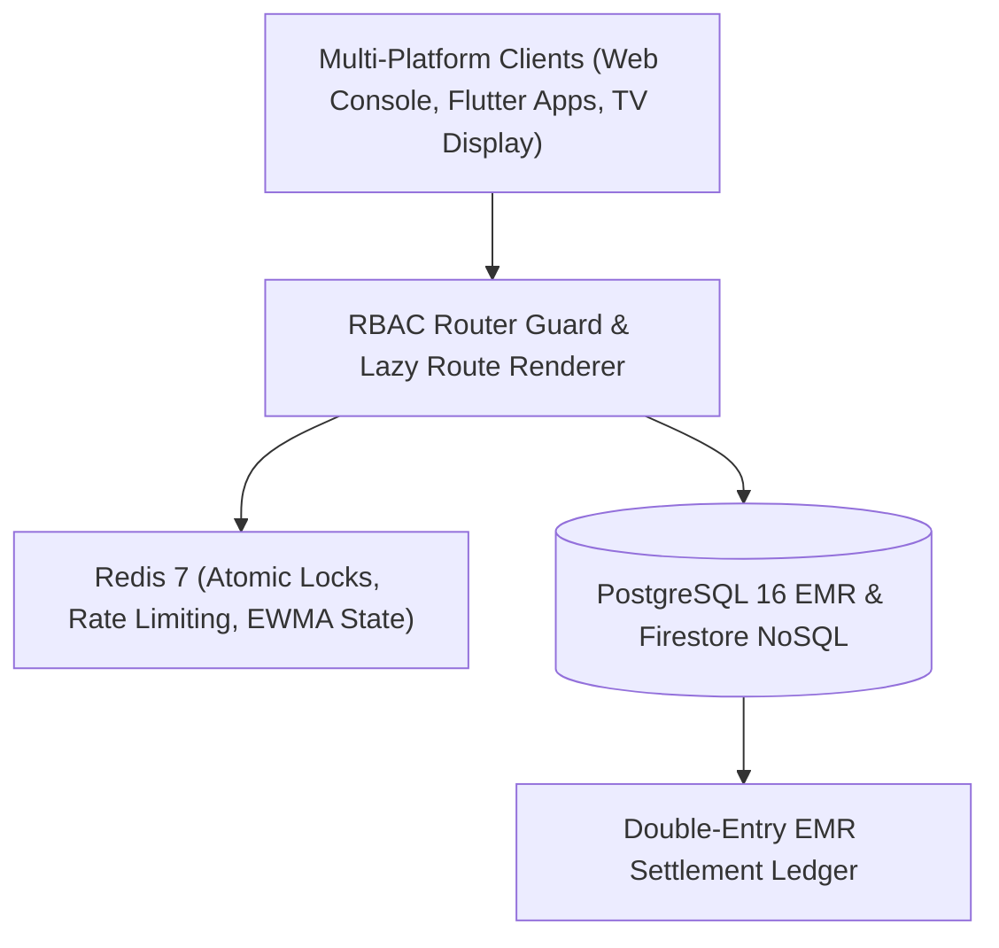

# MediQ – Smart OPD Queue Tracker & Healthcare Marketplace
### Project Code: SOCCA - 12 | Silver Oak University (NAAC A+)

Intelligent OPD queue tracker, clinical triage optimization engine, and hyperlocal 15-minute pharmacy fulfillment ecosystem.

[Live Demo](https://smart-opd-queue-tracker.web.app) | [Docs](docs/DESIGN.md) | [License](LICENSE)


---

## Features
- **Dynamic EWMA Queue Pacing:** Predicts accurate consultation wait times with outlier suppression ($\alpha = 0.35$), preventing chaotic hospital waiting rooms.
- **Role-Based Access Control (RBAC):** Strict security perimeter separating Patient, Doctor, Pharmacy, EV Delivery Rider, and Hospital Admin surfaces.
- **Redis Distributed Locking:** Prevents queue token race conditions when multiple clinical triage staff advance queues simultaneously.
- **Jan Aushadhi Generic Medicine Savings:** Maps branded doctor prescriptions to PMBJP generic salts, saving patients up to 70% on healthcare costs.
- **Double-Entry EMR Financial Ledger:** Audited settlement ledger ensuring balanced accounts across consultations and pharmacy deliveries.
- **Ponytail Route Splitting:** Lazy-loaded modular routing reducing initial web bundle from 1,543 kB to 146 kB (90.5% payload reduction).

## Tech Stack
Frontend: React 19, Vite 6, Tailwind CSS, 4 Native Flutter Apps (Doctor, Patient, Pharmacy, Rider)  
Backend: Node.js, Express, Firebase Cloud Functions v2, Redis 7 (Primitives & Locks)  
Database: PostgreSQL 16 (Relational EMR Schema), Cloud Firestore (Mumbai asia-south1)  
Deploy: Firebase Production Hosting, Docker Compose, Nginx, GitHub Actions CI/CD  

## Architecture



## Getting Started

### Prerequisites
- Node.js 20+ (tested on Node 20 and 24)
- Docker & Docker Compose (optional for local PostgreSQL & Redis)

### Installation
1. Clone the repository:
   ```bash
   git clone https://github.com/yashpatadiya1724-cmyk/OPD.git
   cd OPD
   ```

2. Copy environment template:
   ```bash
   cp .env.example .env
   ```

3. Install dependencies:
   ```bash
   npm install
   ```

4. Run the local development server:
   ```bash
   npm run dev
   ```

5. Run automated test suites:
   ```bash
   npm test
   ```

### Docker Compose (Full Stack with PostgreSQL & Redis)
```bash
docker compose up -d
```

## API & Endpoints
- **Live Production Web Console:** [smart-opd-queue-tracker.web.app](https://smart-opd-queue-tracker.web.app)
- **Waiting Room TV Stream:** [smart-opd-queue-tracker.web.app/?role=tv](https://smart-opd-queue-tracker.web.app/?role=tv)
- **Database Schema:** Defined in [`src/db/schema.sql`](src/db/schema.sql) with demo seed data in [`src/db/seed.sql`](src/db/seed.sql).

## Security and Privacy
- **Strict Role Isolation:** Patients access only their own medical history; doctors access active daily queue patients; riders/pharmacy view delivery addresses and prescription names without clinical diagnostic notes.
- **Audit Logging:** System logs track every actor access (`actor_id`, `role`, `action`, `resource_id`) to ensure compliance with India's Digital Personal Data Protection (DPDP) Act 2023.
- **Rate Limiting:** Sliding-window rate limiter prevents token abuse and scraping.

## Roadmap
- [x] Dynamic EWMA queue pacing engine
- [x] Ponytail lazy route splitting (90.5% bundle reduction)
- [x] Redis atomic queue advance locks & OTP TTL
- [x] PostgreSQL normalized schema & Double-entry EMR ledger
- [ ] National ABDM M1/M2 milestone production integration
- [ ] Automated hospital emergency bed telemetry gateway

## What I Learned
- Monolithic bundles on clinical reception desks severely degrade user experience; dynamic lazy-loading with Vite rollup chunking reduced our payload by over 90%.
- Concurrent token advancement without atomic locks causes duplicate patient calling in high-volume OPDs; Redis atomic locks cleanly solve queue race conditions.
- Adhering to Pradhan Mantri Bhartiya Janaushadhi Pariyojana generic salt formulas drastically cuts prescription costs for rural patients.

## License
MIT
