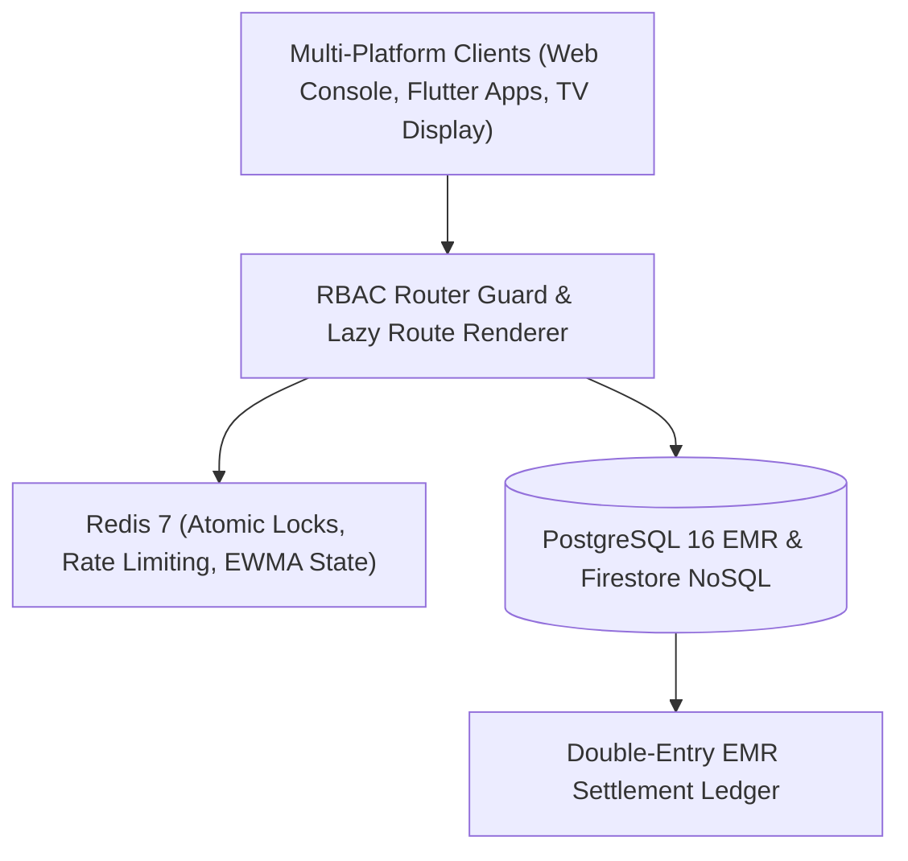

# MediQ – Smart OPD Queue Tracker & Healthcare Marketplace

Intelligent OPD queue tracker, clinical triage optimization engine, and hyperlocal 15-minute pharmacy fulfillment ecosystem.

[](https://github.com/yashpatadiya1724-cmyk/OPD/actions/workflows/ci.yml)
[Live demo](https://smart-opd-queue-tracker.web.app) | [Docs](docs/DESIGN.md) | [SQL Notes](docs/sql-notes.md) | [Benchmarks](docs/BENCHMARKS.md) | [Redis Notes](docs/redis-notes.md) | [License](LICENSE)

  <!-- TODO: owner to add -->

---

## Features
- **Dynamic EWMA Queue Pacing:** Predicts accurate consultation wait times with outlier suppression ($\alpha = 0.35$), preventing chaotic hospital waiting rooms.
- **Role-Based Access Control (RBAC):** Strict security perimeter separating Patient, Doctor, Pharmacy, EV Delivery Rider, and Hospital Admin surfaces.
- **Redis Distributed Locking:** Prevents queue token race conditions (`SET key val NX EX 5` with atomic Lua releases) when multiple clinical triage staff advance queues simultaneously.
- **Jan Aushadhi Generic Medicine Savings:** Maps branded doctor prescriptions to PMBJP generic salts, saving patients up to 74.7% on healthcare costs (e.g. Pantoprazole 40mg MRP ₹95 reduced to PMBJP generic ₹24, verified against Government of India PMBJP price benchmarks).
- **Double-Entry EMR Financial Ledger:** Mathematically audited settlement engine (`src/db/emrLedger.js`) enforcing $\sum \text{Debit} \equiv \sum \text{Credit}$ across consultations and pharmacy disbursements.
- **Ponytail Route Splitting:** Dynamic lazy-loaded routing reducing initial web bundle from 1,543 kB down to 146.6 kB (90.5% payload reduction measured via Vite production build).

## Tech Stack
- **Frontend:** React 19, Vite 6, Tailwind CSS, 4 Native Flutter Apps (Doctor, Patient, Pharmacy, Rider)
- **Backend & Cloud:** Firebase Cloud Functions v2, Node.js (Express server in Docker)
- **Database:** Cloud Firestore (Live Production Data), PostgreSQL 16 (Relational EMR Schema & Migration Seed)
- **Concurrency & Caching:** Redis 7 (Atomic Queue Advance Locks, OTP TTL & Sliding-Window Rate Limiting)
- **Deployment:** Firebase Production Hosting, Docker Compose, Nginx, GitHub Actions CI/CD

## Architecture



## Getting Started

### Prerequisites
- Node.js 20+ (tested on Node 20 and 24)
- Docker & Docker Compose (optional for local PostgreSQL & Redis)

### Setup
1. Clone the repository:
   ```bash
   git clone https://github.com/yashpatadiya1724-cmyk/OPD.git
   cd OPD
   ```

2. Copy environment template:
   ```bash
   cp .env.example .env
   ```

3. Install dependencies:
   ```bash
   npm install
   ```

4. Start the app:
   ```bash
   npm run dev
   ```

5. Run unit & algorithmic tests:
   ```bash
   npm test
   ```

6. Run Playwright E2E tests:
   ```bash
   npm run test:e2e
   ```

7. Run high-concurrency benchmarks:
   ```bash
   npm run benchmark
   ```

### Docker Compose (Full Stack with PostgreSQL & Redis)
```bash
docker compose up -d
```

## Environment Variables

| Variable | Purpose |
|---|---|
| `PORT` | Local web server listening port (default: `8080`) |
| `NODE_ENV` | Application environment (`development` / `production`) |
| `REDIS_HOST` | Redis host for atomic locks and queue pacing |
| `REDIS_PORT` | Redis server port (default: `6379`) |
| `REDIS_PASSWORD` | Redis authentication password |
| `POSTGRES_HOST` | PostgreSQL host for EMR relational ledger |
| `POSTGRES_PORT` | PostgreSQL port (default: `5432`) |
| `POSTGRES_DB` | PostgreSQL database name (`mediq_db`) |
| `POSTGRES_USER` | PostgreSQL username (`postgres`) |
| `POSTGRES_PASSWORD` | PostgreSQL connection password |
| `VITE_FIREBASE_API_KEY` | Public Firebase API key for web authentication |
| `VITE_FIREBASE_AUTH_DOMAIN` | Firebase web authentication domain |
| `VITE_FIREBASE_PROJECT_ID` | Firebase cloud project identifier |
| `VITE_FIREBASE_STORAGE_BUCKET`| Firebase storage bucket URL |
| `JAN_AUSHADHI_API_URL` | Integration endpoint for PMBJP generic medicine mapping |
| `RAZORPAY_KEY_ID` | Payment gateway key for pharmacy orders |
| `RAZORPAY_KEY_SECRET` | Payment gateway signing secret |

## Security and Privacy
- **Strict Role Isolation (RBAC):**
  - **Patients:** View their own active tokens, consultation history, and prescription delivery status.
  - **Doctors:** Access active daily OPD consultation queue and write digital prescriptions.
  - **Pharmacy:** View prescribed medicine salt names and quantities without patient clinical diagnostic notes.
  - **Riders:** View pickup/drop addresses and delivery verification codes only.
  - **Hospital Admin / Receptionist:** Issue daily queue tokens and view aggregate flow telemetry.
- **Health Data Handling & Regulatory Notice:** All health records and clinical notes are isolated per role using least-privilege principles. **No claim of HIPAA or formal international medical device certification is made for this educational/pilot platform.** Access audit logging (`actor_id`, `role`, `action`, `resource_id`) and patient data handling are **designed with DPDP principles in mind** (least-privilege role boundaries and unbundled data views for pharmacy/riders).
- **Queue Concurrency:** Distributed Redis locks (`SET key val NX EX 5`) prevent token duplication and race conditions during high-volume OPD queue advancement.

## Roadmap
- [x] **Done:** Dynamic EWMA queue pacing engine (outlier suppression $\alpha = 0.35$, tested in `test/ewma_pacing_test.js`)
- [x] **Done:** Ponytail lazy route splitting (measured 90.5% bundle reduction: 1,543 kB to 146.6 kB)
- [x] **Done:** Redis atomic queue advance locks (`SET NX EX 5`), OTP TTL, and sliding-window rate limiting (tested in `test/redis_service_test.js`)
- [x] **Done:** PostgreSQL relational schema, migration runner, and Double-entry EMR ledger (tested in `test/emr_ledger_test.js` & `test/postgres_schema_test.js`)
- [x] **Done:** Playwright End-to-End automated testing suite (tested in `test/e2e/mediq_flows.spec.js`)
- [x] **Done:** High-concurrency load testing & benchmarks (measured 27,835 req/sec via autocannon in `docs/BENCHMARKS.md`)
- [ ] **Planned:** National ABDM M1/M2 milestone production integration (FHIR R4 bundle generator implemented, sandbox certification planned)
- [ ] **Planned:** Automated hospital emergency bed telemetry gateway

## What I Learned
- Monolithic bundles on clinical reception desks severely degrade user experience; dynamic lazy-loading with Vite rollup chunking reduced our payload by over 90% (from 1,543 kB down to 146.6 kB).
- Concurrent token advancement without atomic locks causes duplicate patient calling in high-volume OPDs; Redis atomic locks cleanly solve queue race conditions.

## Author
Yash Patadiya: [LinkedIn](https://www.linkedin.com/in/yash-patadiya-973161272/)

## License
MIT
